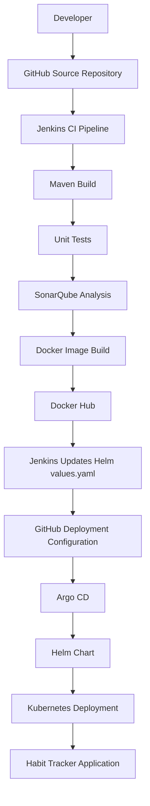

# Habit Tracker – DevOps CI/CD & GitOps Project

A Java Spring Boot Habit Tracker application deployed on Kubernetes using an automated CI/CD and GitOps workflow.

This project demonstrates how to build, test, analyze, containerize, publish, and deploy a Java application using Jenkins, SonarQube, Docker, Helm, Argo CD, and Kubernetes.

## Project Overview

The Habit Tracker application allows users to create and manage daily or weekly habits, track completion, and monitor streaks through a web dashboard.

The project implements:
- Continuous Integration using Jenkins.
- Maven build and unit testing.
- Static code analysis using SonarQube.
- Docker multi-stage image builds.
- Docker Hub image publishing.
- Helm-based Kubernetes deployment.
- GitOps deployment management using Argo CD.
- Automated synchronization of Git changes to Kubernetes.

## Architecture



## Technology Stack

| Category | Technology |
|---|---|
| Application | Java 21, Spring Boot 3.3.4 |
| Build Tool | Maven |
| Source Control | Git, GitHub |
| CI/CD | Jenkins |
| Code Analysis | SonarQube |
| Containerization | Docker |
| Container Registry | Docker Hub |
| Orchestration | Kubernetes (Docker Desktop) |
| Package Management | Helm |
| GitOps | Argo CD |
| Operating Environment | Ubuntu on WSL2, Windows |

## Repository

- **Project Repository:** https://github.com/naviktg/Guvi-Project-5
- **Docker Hub:** https://hub.docker.com/r/navikaran/habit-tracker
- **Docker Image:** `navikaran/habit-tracker`

## Application Features

- Create, update, and delete habits.
- Activate or deactivate habits.
- Mark habits as completed.
- Track current and longest streaks.
- View habit statistics.
- Web dashboard and REST API.

### REST API

| Method | Endpoint | Description |
|---|---|---|
| GET | `/api/habits` | List all habits |
| GET | `/api/habits/{id}` | Get a habit |
| POST | `/api/habits` | Create a habit |
| PUT | `/api/habits/{id}` | Update a habit |
| DELETE | `/api/habits/{id}` | Delete a habit |
| PATCH | `/api/habits/{id}/active` | Activate/deactivate |
| POST | `/api/habits/{id}/complete` | Mark completion |
| DELETE | `/api/habits/{id}/complete` | Remove completion |
| GET | `/api/habits/{id}/stats` | View habit statistics |

## CI Pipeline – Jenkins

The Jenkins Declarative Pipeline performs the following stages:

1. **Checkout** – Retrieves source code from GitHub.
2. **Maven Build** – Compiles and packages the Spring Boot application.
3. **Unit Test** – Executes application tests.
4. **SonarQube Analysis** – Performs static code analysis.
5. **Docker Build** – Creates a multi-stage Docker image.
6. **Docker Push** – Publishes the versioned image to Docker Hub.
7. **Update Helm Configuration** – Updates the image tag in `helm/habit-tracker/values.yaml`.
8. **Push Deployment Config to GitHub** – Commits and pushes the updated Helm configuration.

Jenkins credentials are used for Docker Hub and GitHub authentication. Tokens are not stored directly in the Jenkinsfile.

## Docker

The application uses a multi-stage Dockerfile:

- Maven and Java 21 are used in the build stage.
- The executable Spring Boot JAR is copied into a Java 21 JRE runtime image.
- The application runs as a non-root user.
- `.dockerignore` excludes unnecessary files from the build context.

Build locally:

```bash
docker build -t habit-tracker:v1 .
```

Run locally:

```bash
docker run -d --name habit-tracker -p 8082:8080 habit-tracker:v1
```

Open: http://localhost:8082

## SonarQube

SonarQube is integrated into the Jenkins pipeline for Java source code analysis.

Project key: `habit-tracker`

The analysis includes code quality, reliability, security, and test coverage metrics.

The configured project analysis has successfully passed its Quality Gate. Individual findings and coverage metrics can be reviewed in the SonarQube dashboard.

## Kubernetes and Helm

The application is deployed to Kubernetes using a Helm chart.

Chart location:

```text
helm/
└── habit-tracker/
    ├── Chart.yaml
    ├── values.yaml
    └── templates/
        ├── deployment.yaml
        └── service.yaml
```

Kubernetes deployment configuration includes:

- Two application replicas by default.
- Configurable Docker image repository and tag.
- ClusterIP Service.
- CPU and memory requests and limits.
- Liveness and readiness probes.
- Configurable container and service ports.

Validate the Helm chart:

```bash
helm lint helm/habit-tracker
```

Render Kubernetes manifests:

```bash
helm template habit-tracker helm/habit-tracker \
  --namespace habit-tracker
```

Install the chart:

```bash
kubectl create namespace habit-tracker

helm install habit-tracker helm/habit-tracker \
  --namespace habit-tracker
```

Check deployment:

```bash
kubectl get pods -n habit-tracker
kubectl get deployment,service -n habit-tracker
```

## Argo CD – GitOps Continuous Delivery

Argo CD monitors the GitHub repository containing the Helm deployment configuration.

Application configuration:

| Setting | Value |
|---|---|
| Application | `habit-tracker-gitops` |
| Repository | `https://github.com/naviktg/Guvi-Project-5.git` |
| Branch | `main` |
| Path | `helm/habit-tracker` |
| Destination Namespace | `habit-tracker-gitops` |
| Sync Policy | Automated |

Deployment workflow:

1. Jenkins builds and pushes a new Docker image.
2. Jenkins updates the image tag in Helm `values.yaml`.
3. Jenkins commits and pushes the updated configuration to GitHub.
4. Argo CD detects the Git repository change.
5. Argo CD synchronizes the Helm configuration with Kubernetes.
6. Kubernetes performs the application rollout.

Argo CD manages deployment synchronization. Jenkins does not directly deploy the application using kubectl.

## GitOps Deployment Verification

Check the deployed image:

```bash
kubectl get deployment habit-tracker-gitops \
  -n habit-tracker-gitops \
  -o jsonpath='{.spec.template.spec.containers[0].image}'

echo
```

Check pods:

```bash
kubectl get pods -n habit-tracker-gitops
```

Check deployment:

```bash
kubectl get deployment,service -n habit-tracker-gitops
```

The GitOps deployment was verified with image:

```text
navikaran/habit-tracker:5
```

The subsequent Jenkins build successfully pushed image tag `6` and committed the updated Helm configuration to GitHub. Automatic synchronization verification for that latest build is the next validation step.

## Access the Application

The Kubernetes Service uses ClusterIP.

To access the application locally:

```bash
kubectl port-forward \
  -n habit-tracker-gitops \
  service/habit-tracker-gitops 8083:80
```

Open:

http://localhost:8083

Keep the port-forward terminal running while accessing the application.

## Rollback

Helm revision history can be checked using:

```bash
helm history habit-tracker -n habit-tracker
```

Example rollback to revision 1:

```bash
helm rollback habit-tracker 1 -n habit-tracker
```

Note: This command applies to the original Helm release in the `habit-tracker` namespace. Argo CD-managed resources should be rolled back through GitOps configuration changes.

## Project Structure

```text
Guvi-Project-5/
├── .dockerignore
├── .mvn/
├── Dockerfile
├── Jenkinsfile
├── README.md
├── helm/
│   └── habit-tracker/
│       ├── Chart.yaml
│       ├── values.yaml
│       └── templates/
│           ├── deployment.yaml
│           └── service.yaml
├── mvnw
├── mvnw.cmd
├── pom.xml
├── sonar-project.properties
└── src/
    ├── main/
    └── test/
```

## Important Notes and Limitations

- Habit data is stored in memory using `ConcurrentHashMap`.
- Data is not persistent and can be lost when the application restarts.
- A persistent database is not configured in this project.
- Kubernetes deployment is running locally through Docker Desktop Kubernetes.
- The project does not require AWS resources for its deployment.
- SonarQube analysis is integrated, but Jenkins does not currently enforce a webhook-based `waitForQualityGate` stage.

## Learning Outcomes

Through this project, the following practical skills were implemented:

- Java application build and testing with Maven.
- Jenkins Declarative Pipeline development.
- SonarQube static code analysis.
- Docker multi-stage image creation.
- Docker Hub image publishing.
- Kubernetes Deployment and Service management.
- Helm chart creation and deployment.
- GitOps workflow implementation using Argo CD.
- Automated deployment configuration updates through Git.
- Kubernetes application verification and rollback practices.

## Author

**Navikaran N**

DevOps | AWS | Docker | Jenkins | Git | CI/CD | Linux | Kubernetes | Helm | Argo CD | SonarQube
